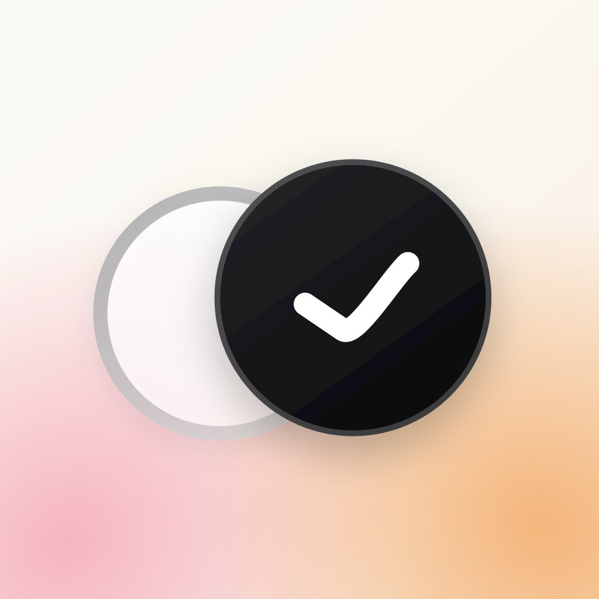

<picture>
  <source media="(prefers-color-scheme: dark)" srcset="https://raw.githubusercontent.com/LeeJams/LeeJams/main/assets/header-dark.svg">
  <source media="(prefers-color-scheme: light)" srcset="https://raw.githubusercontent.com/LeeJams/LeeJams/main/assets/header-light.svg">
  
</picture>

### 안녕하세요, 이재민입니다.

**웹 서비스의 복잡한 흐름을 풀고, 일상의 작은 불편을 앱으로 만듭니다.**

커머스·직원 관리·인증 업무를 지원하는 웹 서비스를 개발해 왔습니다. 
지금은 <strong>헥토데이터</strong>에서 주문 관리 서비스의 백엔드를 개발·운영하고, 
개인으로는 가까운 사람들에게 필요한 앱을 기획부터 출시까지 만들고 있습니다.

  <a href="https://leejams.github.io/about/"><strong>Portfolio ↗</strong></a> &nbsp;·&nbsp;
  <a href="https://leejams.github.io/">Blog</a> &nbsp;·&nbsp;
  <a href="mailto:woals214@gmail.com">Email</a> &nbsp;·&nbsp;
  <a href="https://www.linkedin.com/in/%EC%9E%AC%EB%AF%BC-%EC%9D%B4-285370245/">LinkedIn</a>

 

## 직접 만들고 운영하는 앱

기획·디자인·개발·출시·운영까지 직접 맡은 개인 프로젝트입니다.

<table>
  <tr>
    <td width="48" align="center"></td>
    <td>
      <a href="https://haesseo.inonoi.com/"><strong>했어</strong></a> &nbsp; 가족과 나누는 완료 소식 
      복약과 생활 루틴을 마치면, 선택한 사람에게 소식을 전하는 앱입니다. 
      <a href="https://haesseo.inonoi.com/">서비스 소개 ↗</a> &nbsp;·&nbsp; <a href="https://apps.apple.com/kr/app/id6812309606">App&nbsp;Store</a> &nbsp;·&nbsp; <a href="https://play.google.com/store/apps/details?id=io.leejam.haesseo">Google&nbsp;Play</a>
    </td>
  </tr>
  <tr>
    <td width="48" align="center"></td>
    <td>
      <a href="https://leejams.github.io/about/projects/duty-lounge/"><strong>듀티라운지</strong></a> &nbsp; 교대 근무자를 위한 일정 관리 
      나와 동료들의 근무·휴가 일정을 한곳에서 확인하고 공유하는 앱입니다. 
      <a href="https://leejams.github.io/about/projects/duty-lounge/">개발 이야기 ↗</a> &nbsp;·&nbsp; <a href="https://apps.apple.com/kr/app/id6742709529">App&nbsp;Store</a> &nbsp;·&nbsp; <a href="https://play.google.com/store/apps/details?id=com.leejam.dutylounge">Google&nbsp;Play</a>
    </td>
  </tr>
  <tr>
    <td width="48" align="center"></td>
    <td>
      <a href="https://leejams.github.io/about/projects/fluxile/"><strong>Fluxile</strong></a> &nbsp; iOS · Android 네이티브 퍼즐 
      SwiftUI·SpriteKit과 Kotlin·Compose로 각각 구현한 헥사 블록 퍼즐입니다. 
      <a href="https://leejams.github.io/about/projects/fluxile/">개발 이야기 ↗</a> &nbsp;·&nbsp; <a href="https://apps.apple.com/kr/app/id6790445512">App&nbsp;Store</a> &nbsp;·&nbsp; <a href="https://play.google.com/store/apps/details?id=io.leejam.Fluxile">Google&nbsp;Play</a>
    </td>
  </tr>
</table>

### 오픈소스

<a href="https://github.com/LeeJams/Organization-Chart-Vue3"><strong>organization-chart-vue3</strong></a> 
서비스에 맞게 확장할 수 있는 Vue 3 조직도 컴포넌트입니다. 
TypeScript 타입, 커스텀 슬롯, 선택 이벤트를 제공하며 npm 패키지로 배포합니다. 
<a href="https://www.npmjs.com/package/organization-chart-vue3">npm</a> &nbsp;·&nbsp; <a href="https://leejams.github.io/Organization-Chart-Vue3/">Live demo ↗</a>

 

## 주로 사용하는 기술

| 분야 | 기술 |
| :--- | :--- |
| **Frontend** | TypeScript · React · Next.js · Vue 3 |
| **Backend** | Java · Spring Boot · Node.js · PostgreSQL · Redis |
| **Mobile** | SwiftUI · Kotlin · Jetpack Compose · React Native · Expo |

 

## 개발하며 남긴 기록

문제의 배경과 선택의 이유를 기록합니다. AI를 적극 활용하되, 결과의 근거와 실제 동작을 직접 확인합니다.

- [AI 활용, 속도와 병목 사이 — 사내 발표 후기](https://leejams.github.io/ai-development-speed-and-bottlenecks/)
- [OMS 주문 조회 성능 개선 — PostgreSQL OFFSET 페이징 최적화](https://leejams.github.io/postgresql-order-list-query-optimization/)
- [사용자 입장에서 생각하세요 — 내가 만든 화면은 왜 나에게만 쉬웠을까](https://leejams.github.io/think-like-a-user/)

 

더 많은 프로젝트와 경력은 <a href="https://leejams.github.io/about/">포트폴리오</a>에, 시행착오와 배운 점은 <a href="https://leejams.github.io/archive/">블로그</a>에 정리하고 있습니다.
